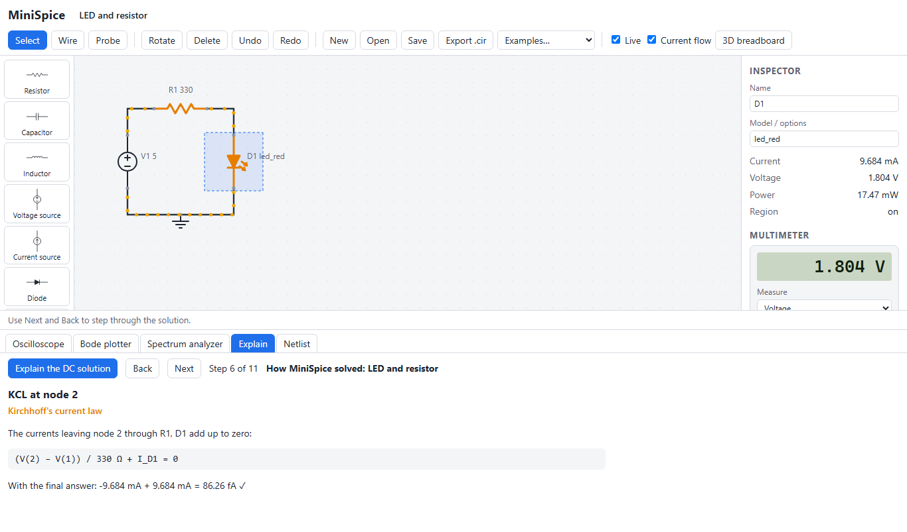
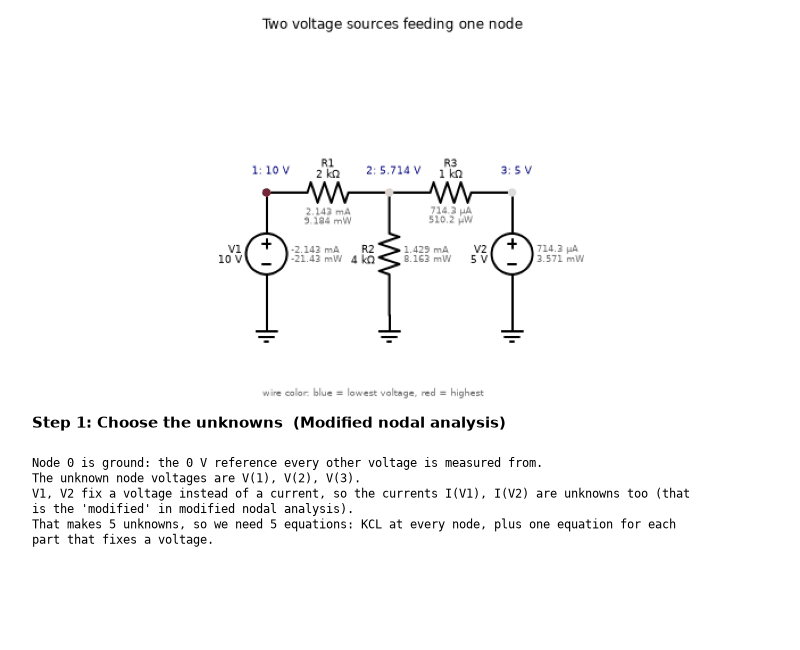
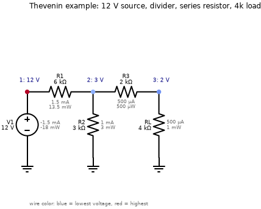
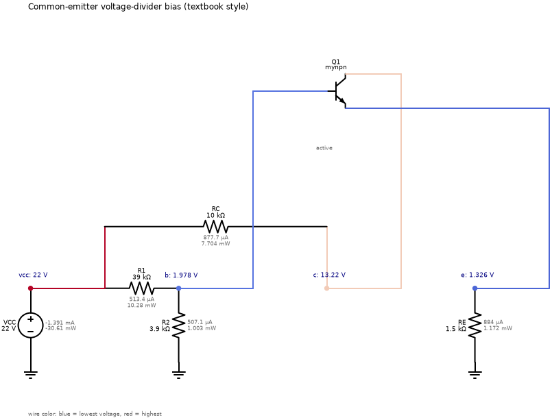
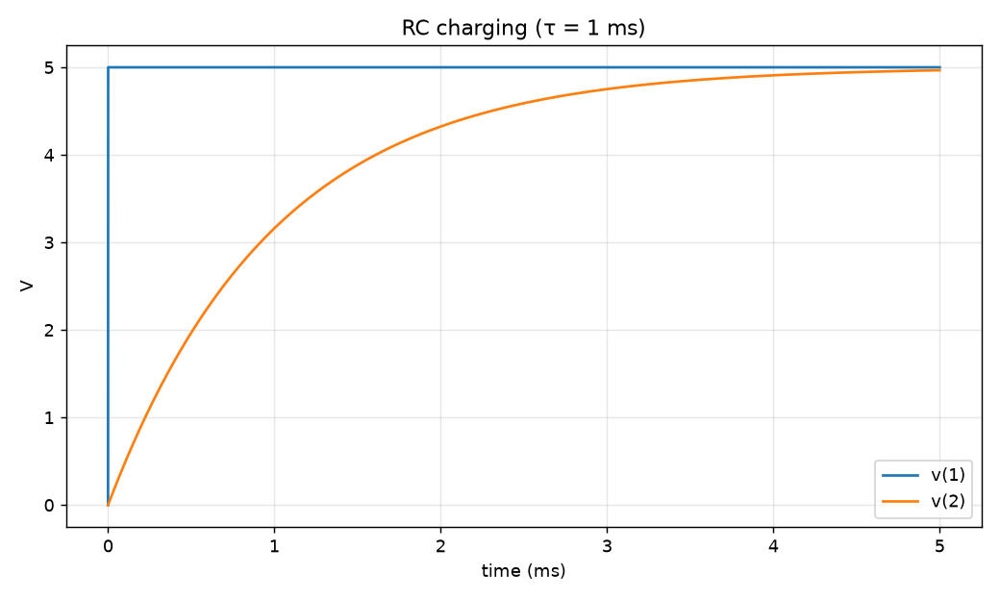
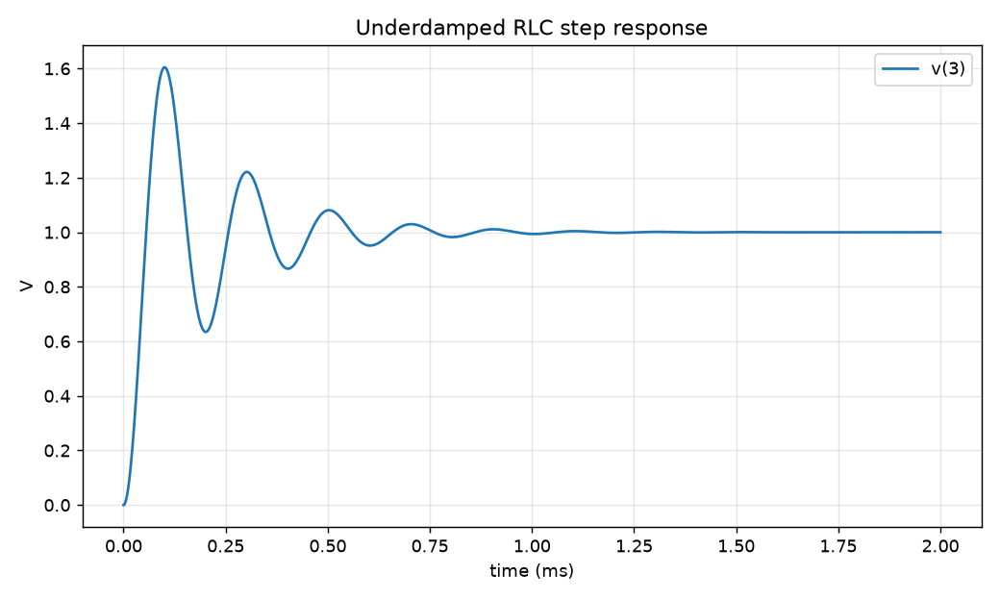
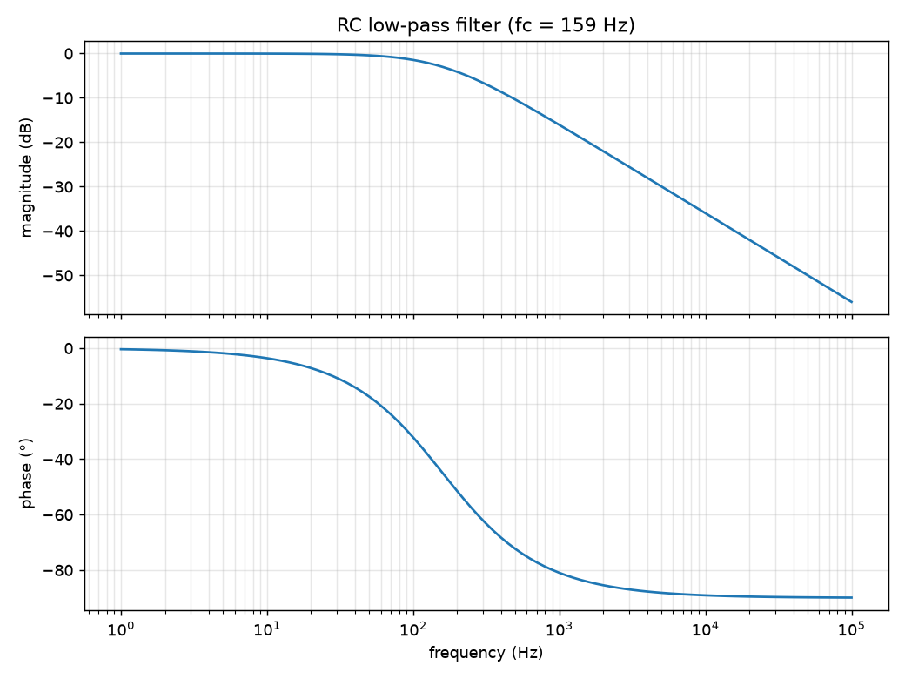

# MiniSpice

[](https://github.com/YOUR-USERNAME/minispice/actions/workflows/tests.yml)


**A circuit simulator that solves circuits with circuit laws and shows its work.** Draw a circuit
(or write a SPICE netlist), and MiniSpice finds every voltage, current and power, then explains
which law it used at each step. It runs in your browser, on the command line, or from Python.



**[Try it in your browser](https://YOUR-USERNAME.github.io/minispice/app/)** · [Documentation](https://YOUR-USERNAME.github.io/minispice/) · [Changelog](CHANGELOG.md)

*(Replace `YOUR-USERNAME` with your GitHub name after pushing, and set Settings > Pages > Source to "GitHub Actions".)*

## Quick start

```
pip install minispice          # once published to PyPI; until then use a copy of the repository:
python -m venv .venv
.venv\Scripts\activate          (Windows)   or   source .venv/bin/activate
pip install -r requirements.txt
python -m minispice examples/divider.cir --dc
```

```
DC operating point
==================
Node  Voltage
----  -------
1     10 V
2     5 V

Part  Type            Voltage  Current  Power absorbed
----  --------------  -------  -------  --------------
V1    voltage source  10 V     -5 mA    -50 mW
R1    resistor        5 V      5 mA     25 mW
R2    resistor        5 V      5 mA     25 mW

Sources deliver 50 mW, parts absorb 50 mW: balanced (sum of all powers = 0 W)
```

## Real hardware

- Five lab circuits with measurement sheets (`examples/lab/`): `python -m minispice compare` lines your multimeter readings up against the simulation and explains differences by simulating part tolerances and the meter's own 10 MΩ loading. See [docs/lab.md](docs/lab.md) for the procedure and the results table.
- Arduino/ESP32 firmware (`firmware/`) streams four analog inputs over USB: record with `python -m minispice measure --port COM3`, then `python -m minispice overlay` plots measured over simulated. In the browser, the oscilloscope's **Connect board** button overlays live readings.
- A 3D breadboard view that shows which hole every leg goes in.

## In the browser (v1.0)

The whole simulator also runs in a web page: the same Python engine, loaded with [Pyodide](https://pyodide.org), so no server is needed and it can be hosted free on GitHub Pages.

```
python web/serve.py        # then open http://localhost:8000
```

- Drag-and-drop schematic editor: parts palette, snapping grid, wires that work out their own nodes, rotate, delete, undo/redo, save/open, and netlist export/import.
- Live simulation: every edit re-solves the circuit; sliders change part values while you watch; animated dots show current flowing, faster for bigger currents; hover anything for its voltage, current and power.
- Virtual instruments: a 4-channel oscilloscope, a multimeter, a Bode plotter and a spectrum analyzer.
- Explain mode in the browser: step through the solution while the parts each step talks about light up.
- A 3D breadboard view with step-by-step build instructions (resistor color bands included).

To publish it, push to GitHub and set Settings > Pages > Source to "GitHub Actions"; `.github/workflows/pages.yml` does the rest.

## Visual and educational (v0.5)



| Annotated schematic | Transistor bias point |
|---|---|
|  |  |

```
python -m minispice examples/two_sources.cir --explain              # step-by-step solution
python -m minispice examples/two_sources.cir --explain solution.pdf # or .tex, .md, .txt
python -m minispice examples/thevenin.cir --schematic thevenin.svg  # annotated drawing
python -m minispice check examples/homework_example.cir             # check your answers
python -m minispice practice --level 2                              # random problems to solve
```

- Schematics drawn automatically from the netlist, with node voltages, currents, power, wires colored by voltage, and overheating parts in red.
- Explain mode: every law the solver used, KCL at each node written out and checked, the matrix, and the power balance.
- Homework checker: finds the first step where your answers go wrong and spots sign errors, unit slips, and forgotten or shorted parts.
- Practice mode with random circuits at four levels.

## Pro-level analysis (v0.4)

```
python -m minispice examples/diode_curve.cir --probe "i(D1)" --plot
python -m minispice examples/divider_tolerance.cir --worst-case --probe "v(2)"
python -m minispice examples/resistor_noise.cir
```

- DC sweeps of sources, part values or temperature, and `.step` parameter sweeps of any analysis.
- Subcircuits with parameters, `.include`, `.model`, and SPICE netlists from other tools.
- Sparse matrices for big circuits: a 10,000-node mesh solves in well under a second ([benchmarks](docs/benchmarks.md)).
- Monte Carlo with part tolerances, worst-case corners, and a ranked sensitivity list.
- Noise analysis: Johnson-Nyquist thermal noise and shot noise, output and input-referred.
- Validation against ngspice: `python tools/compare_ngspice.py` (needs ngspice installed).

## Semiconductors (v0.3)

```
python -m minispice examples/bjt_bias.cir
python -m minispice examples/inverting_amp.cir
python -m minispice examples/two_stage_amp.cir --probe "v(out)" --plot
```

- Controlled sources (E, G, F, H), and ideal or realistic op-amps (finite gain, rail clipping, gain-bandwidth).
- Diodes (Shockley equation), Zener diodes and LEDs, solved with Newton's method and SPICE-style voltage limiting.
- NPN/PNP BJTs (Ebers-Moll) and N/P-channel MOSFETs (square law), with the operating region of each reported.
- Circuit temperature: diode and BJT currents follow kT/q and IS(T); resistors have temperature coefficients.

## Time and frequency (v0.2)

| RC charging | Underdamped RLC | RC low-pass Bode plot |
|---|---|---|
|  |  |  |

```
python -m minispice examples/rc_charge.cir --probe "v(2)" --plot
python -m minispice examples/rc_lowpass.cir --probe "v(2)" --plot
python -m minispice examples/square_wave.cir
```

- Transient analysis with backward Euler or trapezoidal integration and adaptive time steps.
- Step, pulse, sine, piecewise-linear and exponential sources.
- AC analysis with Bode magnitude and phase plots.
- Fourier analysis: harmonics, THD and spectra.
- Coupled inductors, ideal transformers and time-controlled switches.

## DC analysis (v0.1)

- Reads SPICE-style netlists: unit suffixes (`1k`, `4.7u`, `10meg`), comments, `.param`, `.include`, subcircuits.
- DC operating point by modified nodal analysis (Ohm's law, KCL, KVL).
- Power of every part with the passive sign convention, and a conservation-of-energy check.
- Thevenin and Norton equivalents, superposition, and maximum power transfer.
- Clear error messages for floating nodes, voltage-source loops and bad netlist lines.

Run the tests with `pytest`.
